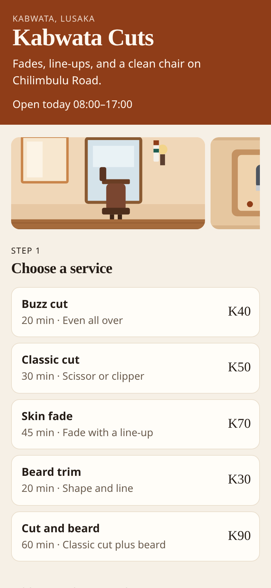
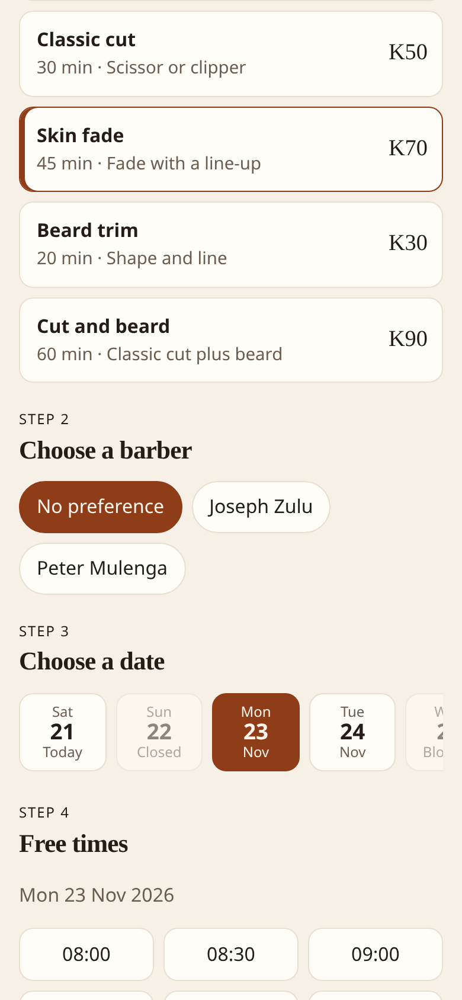
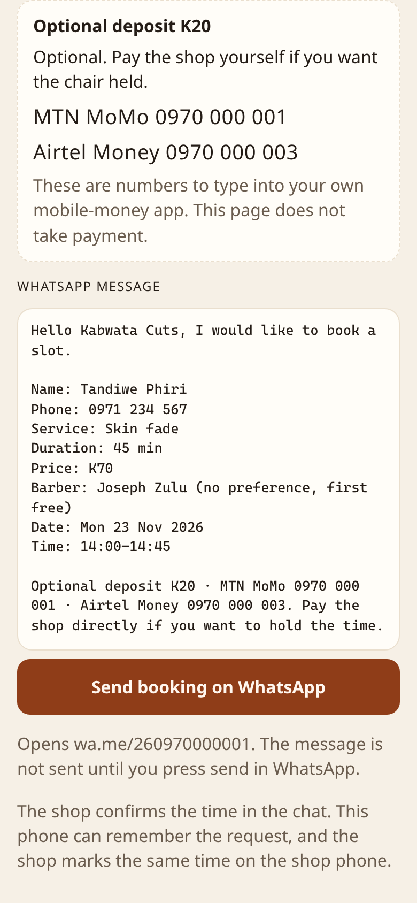
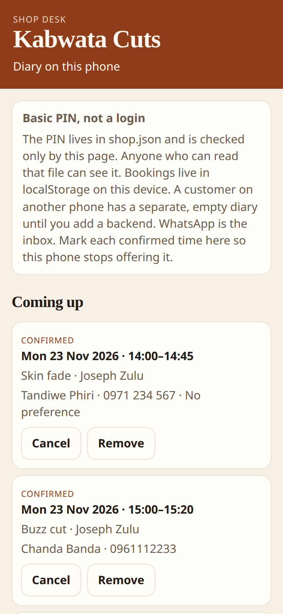
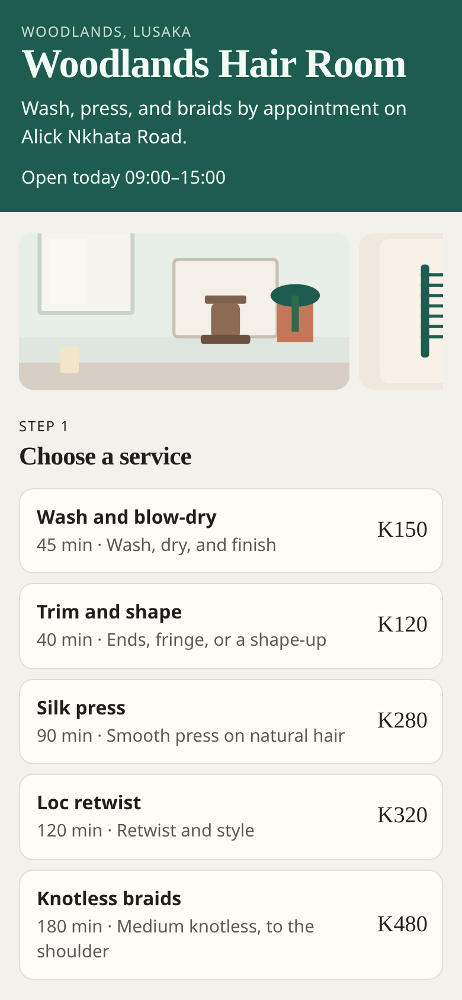

# Lusaka salon booking

A booking page for **one** salon or barber. The customer chooses a service, a date, and a free time, then sends the request on WhatsApp. You copy a folder, edit one config file, and give the shop their own link.

The sample index lists two fictional shops so you can show the work. Customers of a real shop should get that shop's link only. This is a single-shop page, not a marketplace.

Built by [Wankumbu Musunga](https://github.com/MKBright) in Lusaka.

## Try the samples

From this folder:

```bash
python3 -m http.server 8080
```

Open `http://localhost:8080/`.

| Sample | Link | What it shows | Desk PIN |
| --- | --- | --- | --- |
| Kabwata Cuts | `shops/kabwata/` | Barber, two staff, optional K20 deposit | `2468` |
| Woodlands Hair Room | `shops/woodlands/` | Salon, no staff list, longer services | `1357` |

The PINs are printed here so the sample desk can be opened. A real shop should change `ownerPin` in `shop.json`. Sample MoMo, Airtel, and WhatsApp numbers are fictional. Do not send them money.











## Set up a new client

About five minutes once you have their prices and a photo.

1. Copy `shops/kabwata` to `shops/your-client`.
2. Edit `shop.json`: name, WhatsApp number, MoMo and Airtel numbers, hours, services (duration and price in ZMW), blocked dates, and PIN. Set `"staff": []` when the shop is one chair.
3. Replace the files in `photos/` with the shop's own pictures (jpg, png, webp, or svg). Keep each one under about 80KB so the page stays light on mobile data.
4. From the project folder run `python3 -m http.server 8080` and open `http://localhost:8080/shops/your-client/`.
5. Book a test slot and check the WhatsApp message. Open **Shop desk**, enter the PIN, mark a time booked, and confirm that same phone hides the time.
6. Deploy, then send the shop **their folder link only**.

`slotMinutes` is how far apart start times are. `durationMinutes` is how long that visit holds the chair. A 20 minute beard on a 30 minute grid still starts on the grid; the next visit can start once the 20 minutes are over, at the next grid time that does not overlap.

## How bookings work on this page

The diary is `localStorage` in the browser that saved it. The practical workflow is: WhatsApp is the inbox, and the shop phone is the diary.

- A customer on their own phone sends the WhatsApp message. That phone can remember the request, but the shop's phone does not see it.
- The owner opens **Shop desk** on the shop phone, marks the WhatsApp booking (or a walk-in) as booked, or blocks a time. The booking page on **that phone** then hides the time.
- Two customers on two phones can both be offered the same time until you add a backend. The shop confirms in the chat.
- Export CSV from the desk when you want a spreadsheet. The file includes cancelled rows.

### The PIN

The desk PIN is compared, on the device, with `ownerPin` in `shop.json`. The file is part of the static site, so anyone who can load the page can read the PIN. It keeps a customer who is handed the shop phone from opening the diary by accident. It is basic protection, not a secure login. Do not reuse a mobile-money PIN. Change it by editing `shop.json` and deploying again.

Deposits are text. The page shows the shop's MTN MoMo and Airtel Money numbers and never starts a payment.

## Add a backend later

Keep this page and keep `getFreeSlots` in `js/booking-core.js`. That file has no browser APIs, so the same rules can run in Node on a server. The server should be the source of truth so every phone agrees.

1. Give each shop a public id (already in `shop.json`) and a **secret that is not in the static file**.
2. Add a small HTTP API:
   - `GET /api/shops/:id/bookings?from=YYYY-MM-DD&to=YYYY-MM-DD` returns busy ranges only: date, start, duration, staff id, status. Do not send customer phone numbers to the public page.
   - `POST /api/shops/:id/bookings` creates a `requested` booking. Rate-limit it.
   - `POST /api/shops/:id/desk/...` lets the owner confirm, cancel, or block. Check the real secret here.
3. Run `getFreeSlots` on the server before accepting a POST so two customers cannot take one chair.
4. In `js/app.js`, load busy rows with `fetch` instead of reading only `localStorage`. You can keep `localStorage` as a fallback for the shop phone when the network drops.
5. Remove `ownerPin` from `shop.json` once the desk talks to the server. Send the secret over HTTPS. A PIN in a static file will not become a login.
6. Hosts that fit a student budget: a Cloudflare Worker with KV, one small Node process, or Supabase. GitHub Pages can keep serving the HTML.
7. Leave MoMo and Airtel as manual text until you deliberately add a payment provider. Do not add a fake pay button.

When you sell this for real, give the client their own repo or their own host. The two samples share this repo so they can be demonstrated together. Diary keys include the shop id (`lsb.diary.kabwata-cuts`), and `localStorage` is shared by every page on the same domain.

## Deploy on GitHub Pages

Paths are relative, so the site works in a project subfolder such as `/lusaka-salon-booking/` and also at the root of a user site.

1. Push the repository to GitHub.
2. Settings → Pages → Build and deployment → Deploy from a branch → `main` → `/ (root)` → Save.
3. Wait until the Pages workflow finishes.
4. Sample index: `https://<user>.github.io/lusaka-salon-booking/`
5. One shop: `https://<user>.github.io/<repo>/shops/<folder>/`
6. On the shop phone, bookmark that shop URL with `#desk` on the end.

After you change `shop.json`, hard-refresh. The page does not load fonts, analytics, or other third-party hosts, which keeps it usable on a slow connection. There is a `.nojekyll` file so Pages serves every folder as plain files.

## Tests

```bash
node --test
```

GitHub Actions runs the same command on push and on pull requests (`.github/workflows/test.yml`). The tests cover overlapping bookings, closing time, blocked days, closed weekdays, and the `wa.me` message, including a Zambian `097…` number.

## Pricing (estimates)

These figures are **estimates** for a freelancer in Lusaka setting one shop up. They are not a price list from this repository, and they are not a quote until you and the shop agree.

- Setup: about **K800–K2,000**. That is the config, the shop's photos, hours, a short visit, and showing the owner the desk.
- Care: about **K100–K200 per month** if you keep changing prices, staff, or blocked days.

GitHub Pages hosting is free. A custom domain, a backend, and any mobile-money fees are extra. Agree the fee before you start.

## Config reference

`shops/<client>/shop.json`

| Field | Required | Meaning |
| --- | --- | --- |
| `id` | yes | Short slug. Used as the diary key. |
| `name` | yes | Shop name in the header and the WhatsApp message. |
| `tagline`, `area`, `address` | no | Short lines under the name. |
| `whatsapp` | yes | `097…` or `260…`. A leading `0` is rewritten to `260` for `wa.me`. |
| `ownerPin` | yes | At least 4 characters. See the PIN section above. |
| `slotMinutes` | yes | Grid spacing of start times. |
| `bookingWindowDays` | no | How many days ahead the date strip shows. Default 21. |
| `hours` | yes | `monday` … `sunday`. Each day is `{ "open": "08:00", "close": "17:00" }` or `null`. |
| `blockedDates` | no | `YYYY-MM-DD` days with no slots (a holiday, a training day). |
| `services` | yes | `id`, `name`, `durationMinutes`, `priceZmw`, optional `description`. |
| `staff` | no | `id` and `name`. `[]` means one chair. |
| `staffLabel` | no | Word used in the form and the WhatsApp message. Default `Staff`. |
| `photos` | no | `{ "src", "alt" }` relative to the shop folder. |
| `deposit` | no | `amountZmw`, `momo`, `airtel`, `note`. Shown as text only. |
| `theme` | no | `background`, `surface`, `ink`, `muted`, `accent`, `accentInk`, `line`. |

## Credit

[Wankumbu Musunga (@MKBright)](https://github.com/MKBright), Lusaka.
